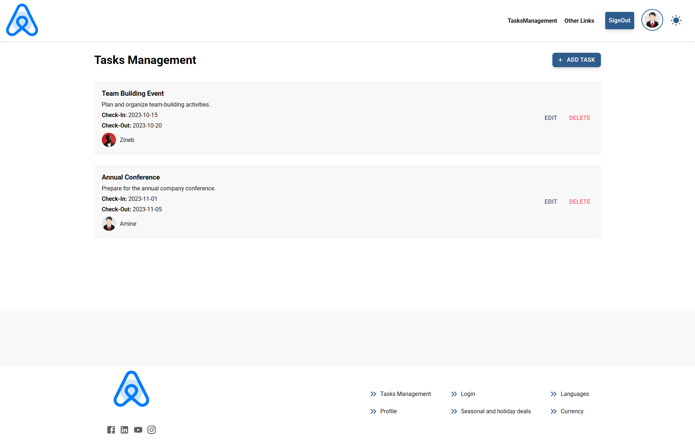
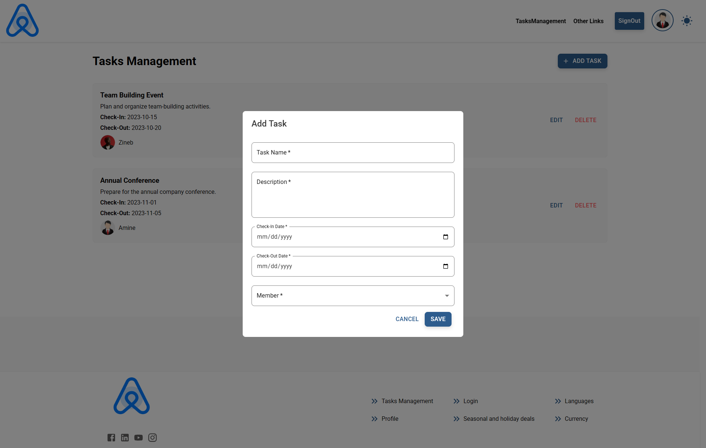
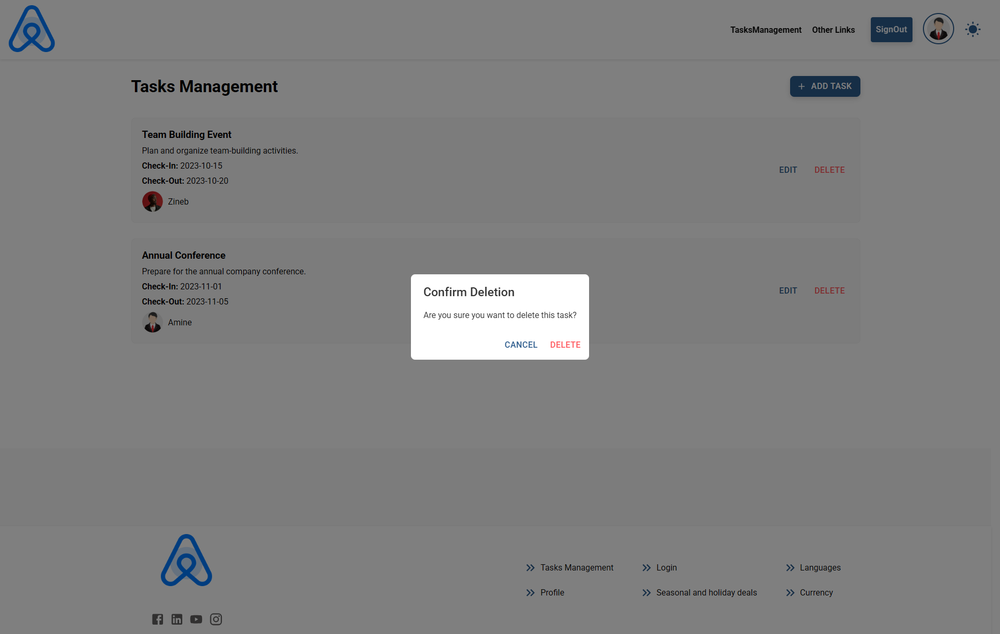
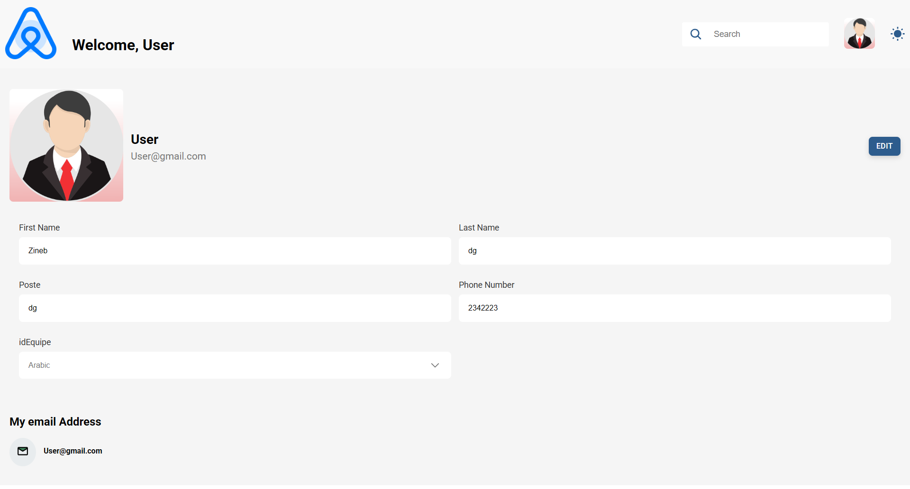

# ProjectHub: Full-Stack Agile Project & Task Management Suite

[](https://dotnet.microsoft.com/)
[](https://learn.microsoft.com/en-us/aspnet/core/)
[](https://learn.microsoft.com/en-us/ef/core/)
[](https://www.microsoft.com/sql-server/)
[](https://react.dev/)
[](https://mui.com/)
[](https://jwt.io/)
[](LICENSE.txt)

**ProjectHub (GestionDesProject)** is an enterprise-grade full-stack Agile project and task management system engineered with an **ASP.NET Core 8 Web API** backend and a **React 18 + Material-UI v6** frontend. Designed for engineering teams and organization managers, it delivers role-based access control (RBAC), team squad management, task lifecycle tracking, light/dark responsive design, and JWT token authentication.

---

## Visual Showcase

| Task Management Grid | Task Creation Modal | Task Deletion Guard |
| :---: | :---: | :---: |
|  |  |  |
| *Interactive task grid with status badges & assignments* | *Creation modal with date pickers & priority assignment* | *Confirmation dialog ensuring safe state management* |

| Light Authentication Portal | Dark Authentication Portal | Member Profile View |
| :---: | :---: | :---: |
|  |  |  |
| *Responsive light authentication UI* | *System-aware dark theme toggle* | *User profile with active team allocations* |

---

## Architectural Highlights

| Dimension | Technical Implementation |
| :--- | :--- |
| **Backend Engine** | ASP.NET Core 8 (`net8.0`) Web API with Dependency Injection & Swagger / OpenAPI |
| **ORM & Database** | Entity Framework Core 9 (`Microsoft.EntityFrameworkCore.SqlServer 9.0.0`) with Code-First Migrations |
| **Object Mapping** | AutoMapper 13.0.1 separating entity persistence from presentation DTO contracts |
| **Authentication & RBAC** | JWT Bearer Authentication (`System.IdentityModel.Tokens.Jwt 8.3.0`) with role validation (`Admin`, `Members`) |
| **Frontend Framework** | React 18.3 SPA with React Router v7 (`react-router-dom 7.0.1`) |
| **Design System** | Material-UI v6 (`@mui/material 6.1.9`, `@mui/icons-material`, `@mui/x-date-pickers`) |
| **State & API Client** | Axios 1.7 HTTP client with automatic Authorization header interception & Date-fns |

---

## System Architecture

```
┌────────────────────────────────────────────────────────┐
│                   React 18 + MUI v6                    │
│ ├── React Router v7 Navigation & Auth Guards           │
│ ├── Material-UI Dark / Light Theme Context             │
│ └── Axios HTTP Client with JWT Bearer Token Injection  │
└───────────────────────────┬────────────────────────────┘
                            │ HTTPS / REST (JSON)
                            ▼
┌────────────────────────────────────────────────────────┐
│               ASP.NET Core 8 Web API                   │
│ ├── JwtBearer Authentication & RBAC Policy Middleware  │
│ ├── Controllers: UsersController, TasksController      │
│ └── AutoMapper Profile: Entities <-> Request/Resp DTOs │
└───────────────────────────┬────────────────────────────┘
                            │ EF Core 9 (LINQ / Migrations)
                            ▼
┌────────────────────────────────────────────────────────┐
│             Microsoft SQL Server Database              │
│ ├── AppUsers (Discriminator: Admin / Members)          │
│ ├── Equipes (Squads & Team Ownership)                  │
│ └── Tasks (Priorities, Due Dates, Statuses)            │
└────────────────────────────────────────────────────────┘
```

---

## Domain Modeling & Relationships

- **`AppUsers` (Base Entity)**:
  - Stores identity fields (`Nom`, `Prenom`, `Email`, `PasswordHash`, `DateInscription`).
  - Implements Table-per-Hierarchy (TPH) inheritance splitting into **`Admin`** and **`Members`**.
- **`Equipe` (Team Entity)**:
  - Represents cross-functional project teams.
  - Linked to an `Admin` owner and contains a collection of assigned `Members`.
- **`Tasks` (Task Entity)**:
  - Core deliverable containing `Titre`, `Description`, `DateDebut`, `DateFin`, `Priorite` (Low, Medium, High), and `Statut` (To Do, In Progress, Done).
  - Linked to a target `Member` assignee and governing `Equipe`.

---

## REST API Endpoints

### Authentication & Users (`/api/Users`)
- `POST /api/Users/login` — Authenticate user and issue signed JWT bearer token.
- `POST /api/Users/register` — Create new administrative or team member account.
- `GET /api/Users/profile` — Retrieve authenticated user profile with team memberships.

### Tasks Management (`/api/Tasks`)
- `GET /api/Tasks` — List tasks filtered by team or assignee.
- `POST /api/Tasks` — Create new task with priority and target deadline.
- `PUT /api/Tasks/{id}` — Update task progress, title, or status transitions.
- `DELETE /api/Tasks/{id}` — Remove task with authorization check.

---

## Project Structure

```
GestionDesProject/
├── dev/
│   ├── front/                   # React 18 frontend application
│   │   ├── src/
│   │   │   ├── components/      # UI widgets, layout navbars, theme switcher
│   │   │   ├── pages/           # Task management, login, profile views
│   │   │   └── services/        # Axios API client & token storage
│   │   └── package.json         # React & MUI dependencies
│   └── pages/                   # Application screenshots & UI figures
├── GestionDesProjectBackEnd/
│   ├── GestionDesProjectBackEnd.sln # Visual Studio Solution
│   └── GestionDesProjectBackEnd/    # ASP.NET Core project root
│       ├── Controller/          # REST API Controllers (TasksController, UsersController)
│       ├── Models/              # Domain entities (AppUsers, Admin, Members, Equipe, Tasks)
│       ├── Data/                # EF Core ApplicationDbContext
│       ├── Migrations/          # EF Core Code-First migration history
│       ├── Dtos/                # Request & Response Data Transfer Objects
│       ├── Program.cs           # Service registration & middleware pipeline
│       └── appsettings.json     # SQL Server connection string & JWT settings
└── README.md                    # Project documentation
```

---

## Getting Started

### Prerequisites

- **.NET 8 SDK**: Version 8.0 or higher installed.
- **Microsoft SQL Server**: LocalDB, Express, or SQL Server 2019/2022 running.
- **Node.js**: Version 18+ and `npm`.

---

### 1. Backend Setup (.NET 8)

1. Navigate to the backend directory:
   ```bash
   cd GestionDesProjectBackEnd/GestionDesProjectBackEnd
   ```

2. Configure database connection in `appsettings.json`:
   ```json
   {
     "ConnectionStrings": {
       "DefaultConnection": "Server=localhost;Database=GestionDesProjectsDB;Trusted_Connection=True;TrustServerCertificate=True;"
     },
     "Jwt": {
       "Key": "your_super_secret_jwt_key_at_least_32_characters_long",
       "Issuer": "ProjectHub",
       "Audience": "ProjectHubClient"
     }
   }
   ```

3. Apply Entity Framework migrations:
   ```bash
   dotnet ef database update
   ```

4. Launch the Web API:
   ```bash
   dotnet run
   ```
   The backend API and Swagger UI will be accessible at `https://localhost:7001/swagger`.

---

### 2. Frontend Setup (React 18 + MUI)

1. Navigate to the frontend directory:
   ```bash
   cd dev/front
   ```

2. Install dependencies:
   ```bash
   npm install
   ```

3. Start the development server:
   ```bash
   npm start
   ```
   The client application opens at `http://localhost:3000`.

---

## Author & Engineering Credits

- **Iliass Wakkar** — Full-Stack & Systems Engineer • [Portfolio](https://www.wakkar.net) • [GitHub](https://github.com/iliass-wakkar) • [LinkedIn](https://www.linkedin.com/in/iliass-wakkar-940233335/)

---

## License

This project is licensed under the MIT License — see the [LICENSE.txt](LICENSE.txt) file for details.
